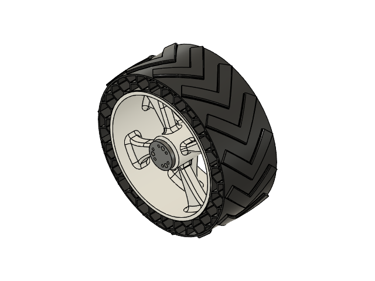

# Terrain Rover

A mobile robotics project integrating mechanical design, electronics, embedded control, and robotics software for terrain mobility.

## Project Overview

The Terrain Rover is being developed as an integrated robotic platform, combining a mechanical chassis, double-rocker mobility mechanism, custom 3D-printed tyres, electronic hardware, and software components.

This repository serves as the central documentation and development space for the rover's mechanical design, electronics, firmware, ROS 2 software, and simulation.

## Mechanical Design

The mechanical subsystem focuses on the rover chassis, mobility mechanism, wheel assemblies, and structural integration.

### Chassis and Structure

The rover structure incorporates:
- **Acrylic sheets** for structural panels and mounting components.
- **Sheet metal** for mechanical panels and structural components.
- **Stainless-steel (SS) tubes** for structural support and mechanical integration.

### Double-Rocker Mechanism

The rover uses a double-rocker mechanism as part of its mobility system, designed to support wheel articulation over uneven terrain.

### Custom 3D-Printed Tyres

The tyres use a dual-material construction:

| Component | Material | Manufacturing |
|---|---|---|
| Outer tyre | TPU 95A | 3D printing |
| Inner rim | PETG | 3D printing |

The flexible TPU outer tyre and rigid PETG inner rim provide complementary material properties within the wheel assembly.

### Mechanical CAD Views

**Rover Assembly**


**Custom Tyre**



For additional rover views, tyre visualisations, and mechanical design details, see the [Mechanical Design Documentation](mechanical/README.md).

## Project Structure

```text
terrain-rover/
├── README.md
├── mechanical/
│   ├── README.md
│   ├── images/
│   ├── cad/
│   └── drawings/
├── electronics/
├── ros2_ws/
```

Directories can be expanded as the corresponding subsystems are developed.

## Development Areas

- **Mechanical Design:** Chassis, double-rocker mechanism, wheel assemblies, and 3D-printed components.
- **Electronics:** Electrical connections, power distribution, motor drivers, and sensors.
- **ROS 2:** Robot software, sensor integration, and navigation, as implemented.

## Current Status

The repository is being developed alongside the rover's mechanical design and subsystem integration. Further implementation details, software modules, and verification results will be added as they become available.
