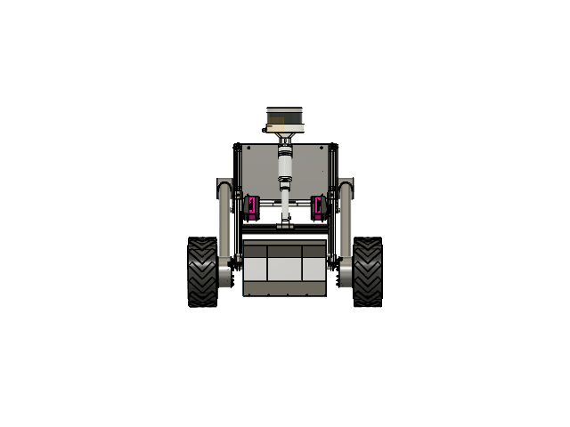
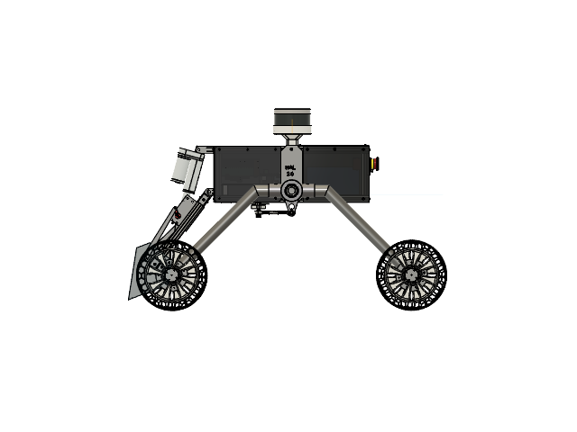
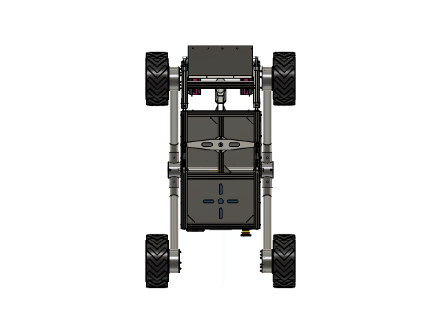
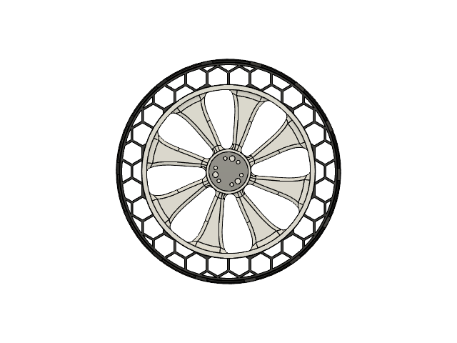
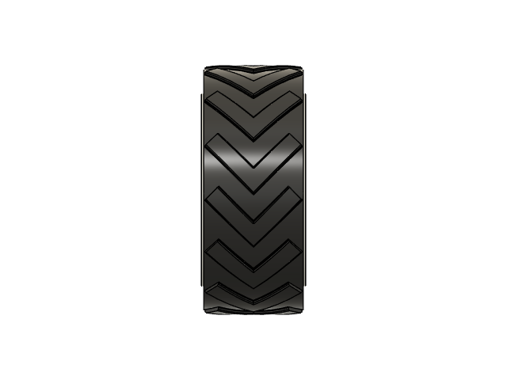
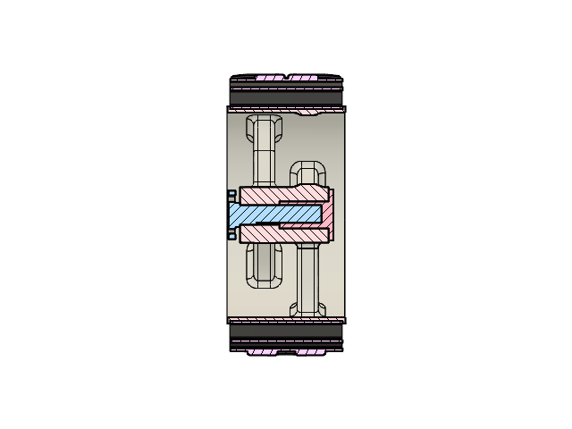

# Mechanical Design – Terrain Rover

## Overview

This directory contains the mechanical CAD design and assembly documentation for the Terrain Rover. The mechanical system includes the chassis, double-rocker mobility mechanism, wheel assemblies, and custom 3D-printed tyres.

## Mechanical Design

### 1. Rover Chassis
The rover structure incorporates acrylic sheets, sheet metal components, and stainless-steel (SS) tubes for structural support, mounting, and mechanical integration.

### 2. Double-Rocker Mechanism
A double-rocker mechanism is used in the rover's mobility system to support wheel articulation over uneven terrain.

### 3. Custom 3D-Printed Tyres
The tyres use a dual-material construction:

- **Outer tyre:** TPU 95A for a flexible, durable tyre surface.
- **Inner rim:** PETG for the rigid supporting structure.

This configuration combines the flexibility of TPU with the structural rigidity of PETG.

## CAD Visualisation

### Rover Assembly

**Isometric View**


**Front View**



**Rear View**


**Side View**



**Bottom View**



### Custom Tyre Design

**Isometric View**


**Front View**



**Side View**



**Cross-Sectional View**



## Materials and Manufacturing

| Component | Material / Process |
|---|---|
| Outer tyre | TPU 95A – 3D printed |
| Inner tyre rim | PETG – 3D printed |
| Structural members | Stainless-steel (SS) tubes |
| Panels and mounting components | Acrylic sheets and sheet metal |

## Directory Structure

```text
mechanical/
├── README.md
├── images/
│   ├── Rover_iso.png
│   ├── Rover_front.png
│   ├── Rover_back.png
│   ├── Rover_left.png
│   ├── Rover_bottom.png
│   ├── Tyre_iso.png
│   ├── Tyre_Front.png
│   ├── Tyre_side.png
│   └── Tyre_cross_Section.png
├── cad/
└── drawings/
```

`cad/` and `drawings/` can contain the corresponding CAD models, assemblies, and engineering drawings when available.
